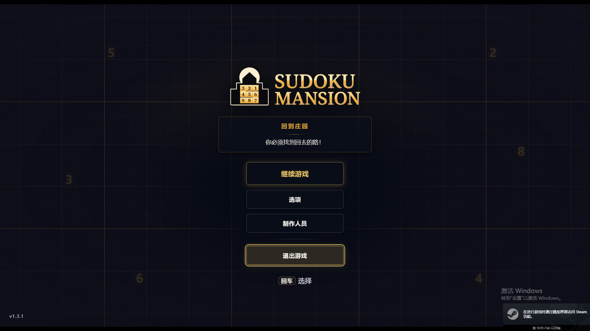

# Sudoku Mansion — Simplified Chinese Patch (adapted for 1.3.2)

[](https://store.steampowered.com/app/5005590/)
[](#)
[](LICENSE)

An **unofficial Simplified Chinese localization** for *Sudoku Mansion*, adapted to game version **1.3.2**.

It builds on [YeWu233/sudoku-mansion-zh-cn](https://github.com/YeWu233/sudoku-mansion-zh-cn)
(the original community patch, which targets 1.2.7) and adds everything 1.3.0 / 1.3.1 / 1.3.2
changed or introduced: new story beats, reworked puzzle rules, the hint system, and new UI strings.



<sub>The main menu after installing (real screenshot).</sub>

> [中文说明](README.md)

## Scope

| Item | Count |
| --- | --- |
| Story / room / rule / help / objective strings | 432 (384 upstream + 48 new) |
| Runtime UI strings (DOM replacement) | 608 (481 upstream + 127 new) |
| Replacements applied at install time | **439 per data file**, no English left behind |

The 1.3.2 content is fully covered: the **three-phase Vault boss** (German Whisper → Region Sum →
Modular), the reworked cage factorial rule, the new poker-hands rule, the Main Hall / Stairways Mod
rules, and the new boss-link editor UI.

## Install

1. Download `Sudoku-Mansion-zh-CN-1.3.2-zh-cn.1.zip` from [Releases](../../releases) (or use `package/`).
2. Extract it and **fully close the game** (make sure no `Sudoku Mansion.exe` is running).
3. In the extracted folder, run:

   ```powershell
   python install.py
   ```

   You can also double-click `安装汉化-1.3.2.ps1`.
4. Launch the game normally from Steam.

The installer locates the Steam install automatically, verifies the game version, counts the
matching strings (439 per file on 1.3.2), backs up the three original files, then writes the
translation and hooks the runtime script into `index.html`. Use `python install.py --dry-run` to
check without touching anything. Python 3 is the only requirement; no network access is needed.

**Restore English:** `python restore.py` (or double-click `还原英文-1.3.2.ps1`).

**Self-check:** `python verify.py`.

## How it works

- Text is matched by **SHA-256 of the original English string**, so a game update can never cause
  a wrong replacement — untranslated/changed strings simply stay English.
- Only three data files are modified (frontend `mansion.json`, backend `mansion_default.json`,
  `index.html`) plus the two added `zh-cn-patch.js` / `zh-cn-patch.css` assets.
  **Save files are never read or written**, and the game binary is untouched.
- UI strings are translated at runtime by exact-matching DOM text and
  `title / aria-label / placeholder / alt` attributes, with a MutationObserver for new nodes.
- Everything is backed up before writing; a failed install rolls back automatically, and
  `restore.py` restores the backup byte-for-byte.

## Changelog

### 1.3.2-zh-cn.1 — 2026-10-12

- Adapted to game **1.3.2**: +16 text entries, +16 UI strings, **439 replacements per file**.
  - The **three-phase Vault boss** (Phase 1/2/3): phasing-boss rule, phase names, unlock story
  - The reworked **cage factorial** rule (digits multiply to N!) and the new **poker hands** rule
  - New rule names: Main Hall Mod, Stairways Mod
- **Fixed: the "check for wrong digits" dialog was entirely in English.**
  - Cause: the dialog body is assembled as `There are N wrong digits in this room.`, while the
    upstream regex required the string to end with a period (`...wrong digits?\.$`) — it could
    never match.
  - Now translated: the body, the `Remove wrong digits` / `Do nothing` / `Rewind` buttons, the
    rewind notes (`Rewinding undoes the last N moves…`, the undo-history warning) and
    `All digits are correct!`, plus common dialog words.
- Engineering: the runtime logic is now generated from `package/zh-cn-patch.template.js`
  (`__MAP__` placeholder) so rebuilding the table can no longer wipe hand-written regexes;
  `install.py` / `restore.py` / `verify.py` tolerate BOM-prefixed JSON.

### 1.3.1-zh-cn.1 — 2026-10-10

- First adaptation: rebased the upstream 1.2.7 translation onto 1.3.1, adding 32 new text entries
  and 111 UI strings.

## After a Steam update

Steam overwrites `index.html` (the hook is lost) and both `mansion.json` files (the translation
reverts to English). Because matching is hash-based and not tied to a version number,
**just re-run `python install.py`** — the existing translation applies again and any new strings
stay English without breaking anything.

To translate newly added text:

```powershell
python package/merge_translation_data.py --game-root "<game folder>"   # list untranslated strings
python package/merge_translation_data.py --apply-json <filled-in.json>
python tools/build_package.py                                          # rebuild package/ and dist/
```

## Known limitations

- Exact-match based: reworded UI strings fall back to English.
- Only strings present in the tables are translated at runtime; brand-new UI text must be added to
  `UI_NEW` in `zh_cn_data.py`.
- The in-game Mansion Editor is translated too, but its wording may not match the official
  terminology everywhere — feedback is welcome.

## License & credits

- Upstream localization: [YeWu233/sudoku-mansion-zh-cn](https://github.com/YeWu233/sudoku-mansion-zh-cn) (MIT) —
  most of the translations and the injection approach come from that project.
  See [THIRD-PARTY-NOTICES.md](package/THIRD-PARTY-NOTICES.md).
- This adaptation is released under the [MIT license](package/LICENSE) as well.
- *Sudoku Mansion* is developed and published by Vault Door Studios. This patch contains **no**
  game files, puzzle data or art assets.
